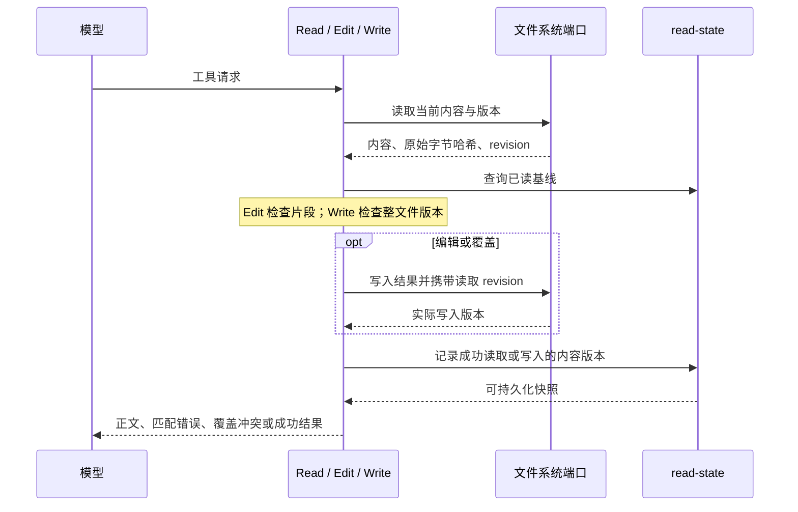

# 文件编辑与覆盖保护 (edit-stale-guard)

## 产品规则

- 局部 Edit 以执行时的当前文件为基础，匹配待替换片段。其他位置变化不阻止编辑；目标不存在或存在歧义时，返回对应匹配错误。replace_all 明确替换全部匹配。
- Edit 保留先读后改与截断视图检查，成功后记录实际写入的完整内容。
- 整文件 Write 对已有文件保留内容版本检查：原始字节哈希相同即可继续，内容变化则拒绝覆盖并要求重新读取。历史记录缺少哈希时沿用时间戳、大小与全文比较。
- Read 的完整读取和范围读取都记录所读文件的原始字节哈希；重复相同视图时，内容版本相同才返回 file_unchanged。重新读取已经变化的文件必须返回当前正文。
- 新产生的读取状态快照保存可选内容哈希，会话恢复后继续使用原有基线；历史快照保持可读。
- 写入携带执行时读取的 revision，文件系统端口负责检查读写间发生的版本变化。

## 状态所有者与顺序

文件系统端口提供内容及其版本，运行时 read-state 唯一保存模型已见的基线，工具 metadata 保存其快照；会话恢复只重放历史基线。

## 验收场景

1. 范围 Read 后仅更新时间戳，Edit 与 Write 均成功。
2. Read 后无关行变化，Edit 保留外部变化并完成唯一目标替换。
3. 目标片段消失或出现多个匹配，Edit 返回具体匹配错误且不写盘。
4. 文件字节变化但大小与时间戳相同，Write 拒绝覆盖；重新 Read 返回当前正文，之后 Write 可成功。
5. 新快照经持久化与恢复后保留哈希，Write 仍识别保留时间戳的修改；旧快照正常恢复。
6. 未读或 token 截断视图继续拒绝编辑；编码、行尾与 replace_all 保持既有语义。
